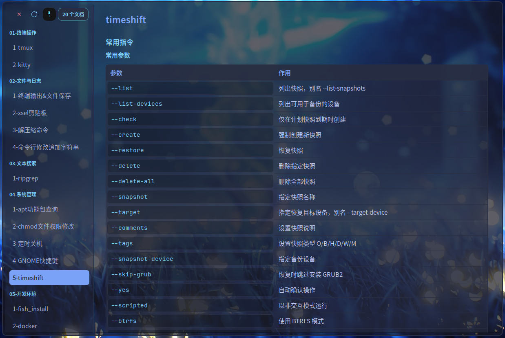

# GTK3-QuickRef

基于 C++17、GTK3 和 cmark-gfm 的本地快捷操作查看器。



以下构建与安装命令均从仓库根目录执行。

## 功能

- 支持 `.txt`、`.md` 和 `.markdown` 文档
- 文件名自动生成标签页
- 左侧文档列表按目录分类，使用自定义页面状态同步正文和高亮
- Markdown AST 映射为原生 GTK 控件，不使用 WebView
- 快捷键表格展示组合键和功能
- 单行指令表格左列和多行长指令代码块提供复制按钮
- 多参数命令提供参数速查表和默认参数省略提示
- 程序只复制命令，不执行命令
- 半透明窗口、圆角和聚焦边框
- 默认不透明度 `0.70`

## 快捷键

| 操作 | 快捷键 |
|---|---|
| 显示窗口 | `Super+Shift+/` |
| 切换标签页 | `Ctrl+Tab` / `Ctrl+Shift+Tab` |
| 切换标签页 | `Alt+↑/↓` |
| 直达标签页 | `Alt+1…9` |
| 浏览内容 | `↑/↓`、`PageUp/PageDown`、`j/k`、`d/u`、`g/G` |
| 调整不透明度 | `Ctrl+Shift+A,  ↑/↓` |
| 切换窗口置顶 | `Alt+P` |
| 重新扫描文档 | `F5 / Ctrl+R` |
| 关闭 | `Esc / Ctrl+W` |

## 文档目录

```text
~/.config/gtk-quickref/pages
```

新增、修改、删除或重命名文档后，重新打开窗口或按 `F5` 即可生效。

Markdown 文档应遵守：

[md文档规范.md](md文档规范.md)

## 配置文件

| 文件 | 用途 |
|---|---|
| `~/.config/gtk-quickref/settings.conf` | 默认不透明度和调整步长 |
| `~/.config/gtk-quickref/style.css` | 窗口与 Markdown 控件样式 |

项目内默认文件：

```text
settings.conf
style.css
```

## 构建依赖

- C++17 编译器
- CMake 3.16+
- GTK3 开发包
- cmark-gfm 开发文件
- pkg-config

缺少 cmark-gfm 开发文件时，`build.sh` 会运行 `bootstrap-deps.sh`，把依赖解压到项目内的 `.deps/`，不需要 root 权限。

## 编译

```bash
./build.sh
```

构建结果：

```text
build/gtk-quickref
```

## 安装

```bash
./install.sh
```

安装内容：

- 可执行文件：`~/.local/bin/gtk-quickref`
- 桌面入口：`~/.local/share/applications/gtk-quickref.desktop`
- 用户配置：`~/.config/gtk-quickref`
- GNOME 快捷键：`Super + Shift + /`

已有用户文档、`style.css` 和 `settings.conf` 不会被覆盖。

## 调试

输出文档载入信息：

```bash
QUICKREF_DEBUG=1 ./build/gtk-quickref
```

临时指定文档目录或样式：

```bash
QUICKREF_DIR=/path/to/pages QUICKREF_STYLE=/path/to/style.css ./build/gtk-quickref
```

## 文档

- [架构说明.md](架构说明.md)
- [md文档规范.md](md文档规范.md)
- [Markdown 模板](templates/quickref-template.md)
- [纯文本模板](templates/quickref-template.txt)
